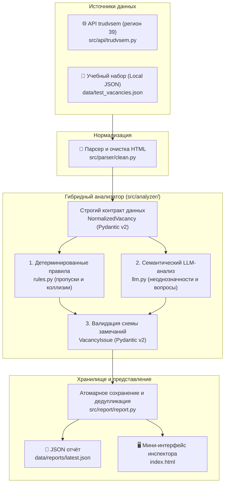

# ПРОЗРАЧНАЯ ВАКАНСИЯ — КАНТКОД

Анализатор вакансий Калининградской области с портала «Работа в России».


## 📺 Видео-демонстрация
[Смотреть видео с демонстрацией проекта](https://disk.yandex.ru/i/yWFVT3G-MC5kQg)

**Посекундный тайминг:**
  * `0:00 – 0:30` — Архитектура и структура модулей.
  * `0:30 – 1:15` — Запуск проверочного режима.
  * `1:15 – 2:00` — Инспектор отчёта: разбор 3 стандартов дефектов.
  * `2:00 – 2:40` — Запуск рабочего режима с реальным API Калининградской области.
  * `2:40 – 2:50` — Финал и итоги работы сервиса.


## 🚀 Установка и запуск

### Скачивание модели

Скачать и установить [Ollama](https://ollama.com) 
или набрать в Windows PowerShell: 
```
irm https://ollama.com | iex
```

Скачать модель, указанную в .env.example
```bash
   ollama pull qwen2.5:7b
```

### Клонирование репозитория

```
git clone https://github.com/Svetlana184/crystal-vacancy.git
cd crystal-vacancy
```

### Настройка окружения и зависимостей

```
python -m venv venv
# macOs/Linux
source venv/bin/activate 
# Windows: venv\Scripts\activate
pip install -r requirements.txt
copy .env.example .env
```


## 💻 Команды выполнения

### 1. Проверочный режим
Запуск пайплайна на учебном датасете

Ollama должна быть запущена в фоне
```bash
python -m src.main run --mode local --file data/mock_vacancies.json
```

### 2. Рабочий режим (реальный API)
Запуск на реальном API

Ollama должна быть запущена в фоне
```bash
python -m src.main run --mode api
```

### 3. Регулярный запуск по расписанию
Запуск фонового планировщика с защитой от дублирования записей:
```bash
python -m src.main schedule
```

### 4. Мини-интерфейс инспектора отчётов
Запуск локального веб-сервера и просмотр отчётов в интерактивном интерфейсе:
```bash
cd .\src\
python -m http.server 8000
```
в браузере - http://localhost:8000/


### 5. Проверка доступности портала «Работа в России»
```bash
python scripts/ping_api.py
```
### 6. Юнит-тесты парсера
```
python -m unittest discover -s tests -v
```


## 🏗 Архитектура и структура модулей

Проект реализован по модульному принципу с единым контрактом данных на базе **Pydantic v2**:




## Роли и задачи участников команды

* [Светлана / Ник на GitHub: Svetlana184]
  * Создала и настроила структуру репозитория и его конфигурацию.
  * Разработала два режима запуска.
  * Осуществила обработку ошибок и сохранение отчетов.
  * Сделала ревью документации.
* [Михаил / Ник на GitHub: kedrovaya-shishka]:
  * Разработал модуль парсинга, очистки HTML и нормализации полей вакансий.
  * Реализовал обработку пропусков, заглушек, сборку вложенных полей и дедупликацию по ID.
  * Составил набор тестовых вакансий в формате API региона 39 и эталонный отчёт.
  * Написал 36 модульных автотестов для проверки всех краевых случаев парсинга.
* [Милана / Ник на GitHub: Oopmie]:
  * Разработала модуль базовых проверок вакансий без ИИ и интегрировала его в пайплайн анализа.
  * Настроила и протестировала автономный запуск языковой модели `qwen2.5:7b` через локальный сервер Ollama.
  * Провела тестирование на наборе  и реальных вакансиях региона 39.
* [Яна / Ник на GitHub: Wksils] (капитан команды)
  * Написала промпт и разбор ответа модели.
  * Реализовала проверку цитат и повторных запросов при некорректном ответе.
  * Подключила ИИ к пайплайну.
  * Осуществила настройку и запуск проверочного режима с локальной моделью.
* [Павел / Github: Pavlik7777] 
  * Разработал интерактивный веб-интерфейса инспектора отчётов с поддержкой мок-данных команды, живых данных Trudvsem и режима презентации.
  * Подготовил документацию.
  * Провел автоматизированную запись демонстрационного видеоролика и сгененрировал озвучку.


### Структура репозитория:
```text
crystal-vacancy/
├── config/
│   └── settings.yaml              # Настройки региона 39, лимитов API и Cron
├── data/
│   ├── mock_expected_report.json  # Эталонный ожидаемый отчёт валидации
│   ├── mock_vacancies.json        # 8 эталонных мок-вакансий
│   └── test_vacancies.json        # Учебный датасет для проверочного режима
├── scripts/
│   └── ping_api.py                # Проверка доступности API trudvsem.ru
├── src/
│   ├── analyzer/                  # Ядро гибридного анализа
│   │   ├── __init__.py            # Пакет анализатора
│   │   ├── index.py               # Оркестратор анализатора вакансий
│   │   ├── llm.py                 # Семантический анализ через языковую модель
│   │   └── rules.py               # Детерминированные правила (пропуски, коллизии)
│   ├── api/
│   │   └── trudvsem.py            # Клиент открытого API портала «Работа в России»
│   ├── parser/
│   │   └── clean.py               # Очистка HTML и нормализация полей
│   ├── report/
│   │   └── report.py              # Атомарное сохранение и дедупликация по ID
│   ├── scheduler/
│   │   └── scheduler.py           # Фоновое обновление по Cron (APScheduler)
│   ├── config.py                  # Загрузка YAML и .env конфигурации
│   ├── main.py                    # Единая точка входа CLI (run, schedule, view)
│   └── schemas.py                 # Pydantic v2 схемы (NormalizedVacancy, VacancyReport)
├── tests/                         # Модульные автотесты (36 тестов нормализатора)
├── .env.example                   # Шаблон переменных окружения
├── .gitignore                     # Исключения Git
├── README.md                      # Документация проекта
└── requirements.txt               # Зависимости Python
```

---


## 🤖 Модель и шаг с ИИ (Гибридный подход)

В проекте реализован **двухэтапный гибридный анализ**:

1. **Детерминированные правила (`src/analyzer/rules.py`):**
   * Мгновенная проверка обязательных полей (`requirements`, `salary`, `location`, `schedule`, `duty`).
   * Логический поиск жестких противоречий (например, в структурированном поле — `полный рабочий день`, а в текстовом описании — `подработка на 2 часа`).
   * Исключает галлюцинации и выполняется за микросекунды.

2. **Семантический анализ языковой моделью (`src/analyzer/llm.py`):**
   * **Где применяется:** анализ поля `duty` (обязанности) и общего описания вакансии на предмет **субъективной размытости** и скрытой двусмысленности.
   * **Что находит ИИ:** формулировки типа *«достойная заработная плата»*, *«высокий доход»*, *«гибкий график без ограничений»*, *«выполнение различных поручений руководства»*.
   * **Промпт и ограничения:** Модель получает инструкцию извлекать **строгую дословную цитату** из текста и формулировать **уточняющий вопрос** работодателю без генерации лишнего текста.
   * **Валидация ответа:** Каждый ответ модели десериализуется в объект `VacancyIssue` через Pydantic. Некорректные ответы отбрасываются.

---

## 📊 Формат отчёта (JSON Schema)

Отчёт атомарно сохраняется в `data/reports/latest.json`.

```json
{
  "generated_at": "2026-11-24T16:26:18.402370",
  "vacancies_count": 4,
  "vacancies": [
    {
      "id": "test-002-missing",
      "url": "https://trudvsem.ru/vacancy/card/test-002",
      "job_name": "Помощник повара",
      "issues": [
        {
          "topic": "требования",
          "field": "requirements",
          "quote": "",
          "issue": "В вакансии не указаны требования к кандидату (образование, стаж, профессиональные навыки)",
          "recommendation": "Уточните обязательные требования: уровень образования, минимальный опыт работы и квалификацию."
        }
      ]
    }
  ]
}
```

### Стандарты классификации 3 типов дефектов по ТЗ:

| Тип дефекта | Поле `"quote"` | Рекомендация (`"recommendation"`) | Пример выявления |
| :--- | :--- | :--- | :--- |
| 🟡 **Пропуск** *(Omission)* | **Строго пустая строка `""`** | Указание, какие обязательные сведения запросить у работодателя | Поле зарплаты, требований или адреса отсутствует |
| 🔵 **Неоднозначность** *(Ambiguity)* | **Точная дословная цитата** из текста | Конкретный уточняющий вопрос об условиях | *«достойная оплата»* ➔ *«Укажите фиксированный оклад»* |
| 🔴 **Противоречие** *(Contradiction)* | **Оба конфликтующих значения через разделитель `\|`** | Указание на конфликт и предложение выбрать одно условие | *«Полная занятость \| Подработка на 2ч»* |


### Формат замечания

| Поле | Описание |
|------|----------|
| `topic` | тема: должность, обязанности, требования, оплата, график, место работы, тип занятости |
| `field` | поле источника; для противоречия два поля через запятую |
| `quote` | точная цитата из поля; для пропуска пустая; для противоречия две цитаты через `\|` |
| `issue` | суть проблемы |
| `recommendation` | что именно уточнить у работодателя |

Если замечаний нет, `issues` — пустой массив.


## 🖥 Мини-интерфейс инспектора

Для наглядного представления результатов разработан легковесный автономный интерфейс:
* **Два режима работы:**
  * 🎬 **Режим «Авто-презентация (2:40)»**: Пошаговая демонстрация всех 4 блоков сценария видеоролика с автоматической синхронизацией слайдов и живой озвучкой.
  * 📋 **Режим «Карточки отчёта»**: Интерактивный инспектор вакансий с фильтрами по статусам (*Все*, *С дефектами*, *Пропуски*, *Неоднозначности*, *Противоречия*, *Идеальные*), поиском и прямыми ссылками на trudvsem.ru.
* **Переключатель датасетов:** мгновенное переключение между `[🎯 Мок команды (8)]`, `[📦 Сценарий ролика (4)]` и `[🌐 Реальные с Trudvsem (50 вакансий)]`.
