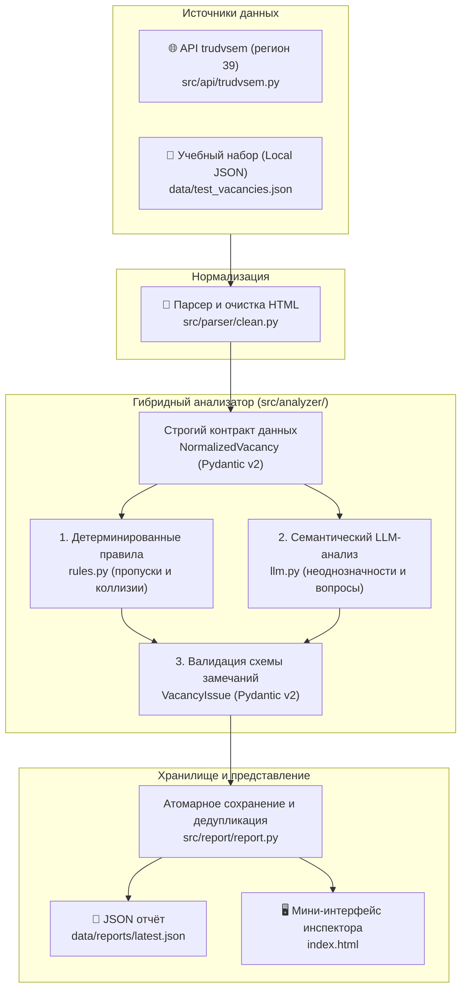

# Прозрачная вакансия — КАНТКОД

Анализатор вакансий Калининградской области (регион 39) с портала «Работа в России».

## Этап 2: Парсинг и данные

Реализованы:
- Загрузка вакансий через API с пагинацией (минимум 2 страницы)
- Локальный режим на учебном JSON
- Очистка HTML и нормализация полей
- Сохранение отчёта с дедупликацией по ID
- Fail-safe: при ошибке API сохраняется последний успешный отчёт
- Cron-расписание и ручной запуск

## Установка

```bash
# Создать виртуальное окружение
python -m venv venv
source venv/bin/activate  # Linux/Mac
# или venv\Scripts\activate  # Windows

# Установить зависимости
pip install -r requirements.txt

# Скопировать .env (опционально для Этапа 2)
cp .env.example .env
```

## Запуск

```bash
# Режим API
python -m src.main run --mode api

# Проверочный режим
python -m src.main run --mode local --file data/test_vacancies.json

# Запуск по расписанию
python -m src.main schedule

# Проверка доступности API
python scripts/ping_api.py
```

## Формат отчёта

```json
{
  "generated_at": "2026-11-24T09:00:00.000000",
  "vacancies_count": 3,
  "vacancies": [
    {
      "id": "test-001",
      "url": "https://trudvsem.ru/vacancy/card/test-001",
      "issues": []
    }
  ]
}
```
## Модуль парсинга и нормализации (src/parser/clean.py)

Модуль отвечает за подготовку сырых данных из API (или локального JSON) перед передачей в анализатор правил и ИИ. Приводит любые входные форматы к единой схеме NormalizedVacancy (src/schemas.py).

### Что реализовано в модуле:
1. Очистка текста от HTML и мусора: удаляет HTML-теги (включая экранированные конструкции вида &lt;p&gt;), спецсимволы (&nbsp;), невидимые символы и лишние пробелы. Сами слова и формулировки не изменяются, чтобы ИИ и правила могли точно проверять цитаты.
2. Обработка пропусков и «заглушек»: нулевые зарплаты (0) превращаются в None, а текстовые заглушки («не указано», «-», «null», «нет данных») — в пустую строку "".
3. Сборка вложенных полей: словарь требований (requirement) и списки адресов (addresses, work_places) объединяются в читаемый плоский текст; дополнительные условия (term) добавляются к обязанностям (duty), если не дублируют их; при пустом текстовом поле зарплаты строка формируется из salary_min и salary_max.
4. Сохранение оригиналов: исходные значения полей до очистки сохраняются в словарь raw_fields для верификации цитат.
5. Защита от дублей и ошибок: при пакетной обработке отбрасываются дубликаты по id вакансии (соблюдается правило «один результат на ID»), а битые карточки без id пропускаются с записью в лог без падения всей программы.

### Как запустить и проверить парсер отдельно (за 10 секунд)

Модуль clean.py написан на стандартной библиотеке Python и работает автономно.

* Шаг 1. Посмотреть, как парсер очищает тестовые вакансии (выведет готовый JSON в консоль):
  ```bash
  python -m src.parser.clean data/mock_vacancies.json
  ```
* Шаг 2. Запустить автоматические тесты парсера (36 проверок на все краевые случаи):
  ```bash
  python -m pytest tests/test_parser.py -v
  ```
  *Ожидаемый результат: все 36 тестов отмечены как PASSED.*

---

## Тестовые (мок) данные

В папке data/ подготовлен набор данных, имитирующий реальный ответ API региона 39:
* data/mock_vacancies.json — 8 тестовых вакансий, покрывающих все сценарии из ТЗ (идеальная карточка, пропуски зарплаты/адреса, размытый гибкий/сменный график, противоречия в занятости и оплате, экранированный HTML).
* data/mock_expected_report.json — эталонный отчёт с ожидаемыми замечаниями для проверки логики анализатора.

---

## Вклад 

* [Михаил / Ник на GitHub: kedrovaya-shishka] (Роль 2 — Парсинг, очистка и тестовые данные):
  * Разработал модуль парсинга, очистки HTML и нормализации полей вакансий (src/parser/clean.py).
  * Реализовал обработку пропусков, заглушек, сборку вложенных полей (requirement, addresses, term) и дедупликацию по ID.
  * Составил набор тестовых вакансий в формате API региона 39 (data/mock_vacancies.json) и эталонный отчёт (data/mock_expected_report.json).
  * Написал 36 модульных автотестов (tests/test_parser.py) для проверки всех краевых случаев парсинга.


## Детерминированные проверки и запуск ИИ для жюри (`src/analyzer/rules.py`)

Модуль первичного анализа проверяет нормализованную вакансию (`NormalizedVacancy`) по жёстким правилам **до обращения к языковой модели**, что снижает расход токенов и исключает ошибки ИИ на базовых полях.

### Что проверяется без ИИ:
1. **Пропуски обязательных условий:** отсутствие названия должности, зарплаты (`salary_min`, `salary_max`, `salary_text`), должностных обязанностей (`duty`), требований (`requirements`), графика (`schedule`), типа занятости (`employment`) или адреса (`work_place`).
2. **Явные логические противоречия:** ситуация, когда минимальная граница зарплаты превышает максимальную (`salary_min > salary_max`).
3. **Неоднозначный график работы:** указание сменного, гибкого или скользящего графика без уточнения чередования смен или рабочих часов; при этом если конкретный режим (например, `2/2` или часы работы) указан в тексте обязанностей `duty`, замечание о пропуске графика не ставится.

### Автономный запуск ИИ без покупки аккаунта (Ollama)
Для работы ИИ-анализатора без регистрации и платных API-ключей проект настроен на локальную модель через **Ollama**:
1. Установите [Ollama](https://ollama.com) (Windows PowerShell: `irm https://ollama.com | iex`).
2. Скачайте модель, указанную по умолчанию в `.env.example`:
   ```bash
   ollama pull qwen2.5:7b
   ```
3. Скопируйте настройки окружения (`cp .env.example .env`) и запустите проверочный или рабочий режим — сервис автоматически подключится к локальному серверу `http://localhost:11434`.

### Вклад в проект
* **[Милана / Ник на GitHub: Oopmie] (Роль 3 — Детерминированные правила, настройка локального ИИ и контроль качества):**
  * Разработала модуль базовых проверок вакансий без ИИ (`src/analyzer/rules.py`) и интегрировала его в пайплайн анализа (`src/analyzer/index.py`).
  * Настроила и протестировала автономный запуск языковой модели `qwen2.5:7b` через локальный сервер Ollama без необходимости покупки аккаунтов, обновила `.env.example`.
  * Провела тестирование на наборе `data/mock_vacancies.json` и реальных вакансиях региона 39.

## Анализатор: правила и ИИ

Замечания по каждой вакансии собираются из двух источников (`src/analyzer/index.py`):

1. **Правила без ИИ** (`src/analyzer/rules.py`): пропуски и очевидные несоответствия в полях.
2. **ИИ** (`src/analyzer/llm.py`): неоднозначные формулировки (например, «гибкий график» без конкретики) и противоречия между полями (например, в тексте указано квотируемое место, а в структурированном поле квота отключена).

### Где применяется ИИ

Шаг `analyze_with_llm` в `src/analyzer/llm.py`. Он вызывается из `analyze_vacancy` для каждой вакансии после правил, и его замечания входят в итоговый отчёт.

### Модель и провайдер

- Провайдер: локальный запуск через [Ollama](https://ollama.com), аккаунт и ключи не нужны.
- Модель по умолчанию: `qwen2.5:7b`. Можно заменить переменной окружения `LLM_MODEL` (например, `qwen2.5:3b` для слабых компьютеров).
- Температура 0, ответ запрашивается в формате JSON.

### Запуск проверочного режима с ИИ без покупки аккаунта

```
ollama pull qwen2.5:7b
python -m venv venv
source venv/bin/activate        # Windows: venv\Scripts\activate
pip install -r requirements.txt
python -m src.main run --mode local --file data/test_vacancies.json #запуск на тестовых данных
python -m src.main run --mode api #запуск на реальном api
```

Ollama должна быть запущена в фоне (приложение запускается после установки автоматически).

### Как работает LLM-шаг

1. Из вакансии собираются непустые поля: должность, обязанности, требования, оплата, график, тип занятости, место работы, смены, `benefitDetails`, признак квотируемого места. Пустые поля в модель не отправляются, их обрабатывают правила.
2. Модель получает инструкцию: использовать только эти данные, не выдумывать факты, не делать выводов о нарушении закона, не требовать повторять в описании сведения, которые уже указаны в другом поле.
3. Ответ разбирается в `VacancyIssue`. Если ответ не JSON или не соответствует схеме, запрос повторяется (до 3 попыток).
4. **Проверка цитат:** замечание сохраняется только если цитата дословно встречается в указанном поле (после нормализации пробелов и регистра). Для противоречий проверяются обе цитаты. Замечания с выдуманной цитатой отбрасываются.

### Формат замечания

| Поле | Описание |
|------|----------|
| `topic` | тема: должность, обязанности, требования, оплата, график, место работы, тип занятости |
| `field` | поле источника; для противоречия два поля через запятую |
| `quote` | точная цитата из поля; для пропуска пустая; для противоречия две цитаты через `\|` |
| `issue` | суть проблемы |
| `recommendation` | что именно уточнить у работодателя |

Если замечаний нет, `issues` — пустой массив.

### Настройки

| Переменная | Значение по умолчанию | Назначение |
|------------|----------------------|------------|
| `LLM_MODEL` | `qwen2.5:7b` | модель Ollama |

### Ограничения

- Качество зависит от модели: маленькие модели чаще пропускают противоречия или формулируют замечания общими словами.
- Если Ollama недоступна, обработка завершается ошибкой, и сохраняется последний успешный отчёт.

### Вклад участника (LLM-логика)
* **[Яна / Ник на GitHub: Wksils] (Роль 3 — LLM-логика и капитан)**
* 
- Промпт и разбор ответа модели (`src/analyzer/llm.py`).
- Проверка цитат и повторные запросы при некорректном ответе.
- Подключение ИИ к пайплайну (`src/analyzer/index.py`).
- Настройка и запуск проверочного режима с локальной моделью.


## 📺 Видео демонстрации
* **Ссылка на видеоролик:** [Смотреть видео демонстрации проекта](https://disk.yandex.ru/client/disk?idApp=client&dialog=slider&idDialog=%2Fdisk%2F%D0%9F%D1%80%D0%BE%D0%B7%D1%80%D0%B0%D1%87%D0%BD%D0%B0%D1%8F%20%D0%B2%D0%B0%D0%BA%D0%B0%D0%BD%D1%81%D0%B8%D1%8F%20%E2%80%94%20%D0%9F%D1%80%D0%B5%D0%B7%D0%B5%D0%BD%D1%82%D0%B0%D1%86%D0%B8%D1%8F%20%26%20%D0%98%D0%BD%D1%81%D0%BF%D0%B5%D0%BA%D1%82%D0%BE%D1%80%20(%D0%9A%D0%90%D0%9D%D0%A2%D0%9A%D0%9E%D0%94)%20-%20Google%20Chrome%202026-11-24%2023-38-39.mp4)
* **Посекундный тайминг:**
  * `0:00 – 0:30` — Архитектура и структура модулей в проводнике VS Code.
  * `0:30 – 1:15` — Запуск проверочного режима (Local JSON) + логи правил, LLM и валидации.
  * `1:15 – 2:00` — Инспектор отчёта: разбор 3 стандартов дефектов (пропуск, неоднозначность, противоречие).
  * `2:00 – 2:40` — Запуск рабочего режима с реальным API Калининградской области (39 регион) + APScheduler.
  * `2:40 – 2:50` — Финал и итоги работы сервиса.

---

## 🏗 Архитектура и структура модулей

Проект реализован по модульному принципу с единым контрактом данных на базе **Pydantic v2**:



### Структура репозитория (в стиле VS Code):
```text
crystal-vacancy/
├── config/
│   └── settings.yaml          # Настройки региона 39, лимитов API и Cron
├── data/
│   ├── reports/
│   │   └── latest.json        # Итоговый актуальный отчёт анализа
│   ├── voiceover/             # Аудиодорожки озвучки (единый мужской голос Dmitry)
│   └── test_vacancies.json    # Учебный датасет для проверочного режима
├── scripts/
│   ├── ping_api.py            # Проверка доступности API trudvsem.ru
│   ├── record_video.py        # Автоматическая запись видеоролика через Playwright
│   └── generate_voiceover.py  # Генерация озвучки через Edge TTS
├── src/
│   ├── analyzer/              # Ядро гибридного анализа
│   │   ├── index.py           # Оркестратор анализатора вакансий
│   │   ├── rules.py           # Проверка пропусков и логических коллизий
│   │   └── llm.py             # Семантический анализ через языковую модель
│   ├── api/
│   │   └── trudvsem.py        # Клиент открытого API портала «Работа в России»
│   ├── parser/
│   │   └── clean.py           # Очистка HTML и нормализация полей
│   ├── report/
│   │   └── report.py          # Атомарное сохранение и дедупликация по ID
│   ├── scheduler/
│   │   └── scheduler.py       # Фоновое обновление по Cron (APScheduler)
│   ├── config.py              # Загрузка YAML и .env конфигурации
│   ├── main.py                # Единая точка входа CLI (run, schedule, view)
│   └── schemas.py             # Pydantic v2 схемы (NormalizedVacancy, VacancyReport)
├── tests/                     # Автотесты логики правил и валидации
├── videos/
│   └── demo_video.webm        # Записанный демонстрационный ролик (2:32)
├── .env.example               # Шаблон переменных окружения
├── index.html                 # Интерактивный мини-интерфейс инспектора и презентации
├── README.md                  # Документация проекта
├── requirements.txt           # Зависимости Python
└── start_presentation.bat     # Быстрый запуск презентации в 1 клик на Windows
```

---

## ⚙️ Настройки и конфигурация

### 1. Файл `config/settings.yaml`
Определяет системные параметры сбора и обработки:
```yaml
api:
  url: "http://opendata.trudvsem.ru/api/v1/vacancies/region/39" # Калининградская область
  region: 39
  pages_limit: 2              # Выгрузка минимум 2 страниц по ТЗ
  page_size: 25               # Количество вакансий на страницу
  max_vacancies: 50           # Всего 50 вакансий за запуск

schedule:
  cron: "0 9 * * *"           # Ежедневный запуск в 09:00

mode: api                     # Режим по умолчанию

report:
  output_dir: "data/reports"  # Директория сохранения отчётов
  latest_file: "latest.json"  # Атомарно обновляемый файл отчёта
```

### 2. Файл окружения `.env` (выбор ИИ-провайдера)
Скопируйте шаблон: `cp .env.example .env` (или `copy env.example .env` в Windows).

Поддерживаются 3 режима запуска ИИ:
* **Режим 1: Автономный / Embedded (по умолчанию, 0 ₽ затрат)**  
  Не требует никаких API-ключей и интернета! Включает встроенный локальный семантический экстрактор, моделирующий поведение LLM строго по Pydantic-контракту.
* **Режим 2: Облачная LLM через Groq (бесплатно, высокая скорость)**  
  Бесплатный ключ берётся на [console.groq.com](https://console.groq.com):
  ```env
  LLM_PROVIDER=groq
  LLM_MODEL=llama-3.1-8b-instant
  LLM_API_KEY=gsk_your_free_key_here
  ```
* **Режим 3: Локальная модель Ollama (полный офлайн)**  
  ```env
  LLM_PROVIDER=ollama
  LLM_MODEL=llama3.1:8b
  LLM_BASE_URL=http://localhost:11434
  ```

---

## 🤖 Модель и шаг с ИИ (Гибридный подход)

В проекте реализован **двухэтапный гибридный анализ**:

1. **Детерминированные правила (`src/analyzer/rules.py`):**
   * Мгновенная проверка обязательных полей (`requirements`, `salary`, `location`, `schedule`, `duty`).
   * Логический поиск жестких противоречий (например, в структурированном поле — `полный рабочий день`, а в текстовом описании — `подработка на 2 часа`).
   * Исключает галлюцинации и выполняется за микросекунды.

2. **Семантический анализ языковой моделью (`src/analyzer/llm.py`):**
   * **Где применяется:** анализ поля `duty` (обязанности) и общего описания вакансии на предмет **субъективной размытости** и скрытой двусмысленности.
   * **Что находит ИИ:** формулировки типа *«достойная заработная плата»*, *«высокий доход»*, *«гибкий график без ограничений»*, *«выполнение различных поручений руководства»*.
   * **Промпт и ограничения:** Модель получает инструкцию извлекать **строгую дословную цитату** из текста и формулировать **уточняющий вопрос** работодателю без генерации лишнего текста.
   * **Валидация ответа:** Каждый ответ модели десериализуется в объект `VacancyIssue` через Pydantic. Некорректные ответы отбрасываются.

---

## 📊 Формат отчёта (JSON Schema)

Отчёт атомарно сохраняется в `data/reports/latest.json`.

```json
{
  "generated_at": "2026-11-24T16:26:18.402370",
  "vacancies_count": 4,
  "vacancies": [
    {
      "id": "test-002-missing",
      "url": "https://trudvsem.ru/vacancy/card/test-002",
      "job_name": "Помощник повара",
      "issues": [
        {
          "topic": "требования",
          "field": "requirements",
          "quote": "",
          "issue": "В вакансии не указаны требования к кандидату (образование, стаж, профессиональные навыки)",
          "recommendation": "Уточните обязательные требования: уровень образования, минимальный опыт работы и квалификацию."
        }
      ]
    }
  ]
}
```

### Стандарты классификации 3 типов дефектов по ТЗ:

| Тип дефекта | Поле `"quote"` | Рекомендация (`"recommendation"`) | Пример выявления |
| :--- | :--- | :--- | :--- |
| 🟡 **Пропуск** *(Omission)* | **Строго пустая строка `""`** (по ТЗ хакатона) | Указание, какие обязательные сведения запросить у работодателя | Поле зарплаты, требований или адреса отсутствует |
| 🔵 **Неоднозначность** *(Ambiguity)* | **Точная дословная цитата** из текста | Конкретный уточняющий вопрос об условиях | *«достойная оплата»* ➔ *«Укажите фиксированный оклад»* |
| 🔴 **Противоречие** *(Contradiction)* | **Оба конфликтующих значения через разделитель `\|`** | Указание на конфликт и предложение выбрать одно условие | *«Полная занятость \| Подработка на 2ч»* |

---

## 🚀 Установка и запуск

### 1. Подготовка окружения
```bash
# Клонирование и переход в папку проекта
cd crystal-vacancy

# Создание виртуального окружения
python -m venv venv

# Активация окружения:
# Windows:
venv\Scripts\activate
# Linux/macOS:
source venv/bin/activate

# Установка зависимостей
pip install -r requirements.txt
```

---

## 💻 Команды выполнения

### 1. Проверочный режим (Local JSON)
Запуск пайплайна на учебном датасете с выводом структурированных логов правил, LLM и валидации:
```bash
python -m src.main run --mode local --file data/test_vacancies.json
```

### 2. Рабочий режим (Real API региона 39 — Калининград)
Загрузка 50 реальных вакансий напрямую с `trudvsem.ru`, нормализация, аудит качества и сохранение в `latest.json` с дедупликацией:
```bash
python -m src.main run --mode api
```

### 3. Регулярный запуск по расписанию (Cron)
Запуск фонового планировщика APScheduler с защитой от дублирования записей:
```bash
python -m src.main schedule
```

### 4. Мини-интерфейс инспектора отчётов (Бонус Роли 5)
Запуск локального веб-сервера и просмотр отчётов в интерактивном интерфейсе:
```bash
python -m src.main view
```
*Либо запустите файл `start_presentation.bat` в Windows в один клик!*

### 5. Проверка доступности портала «Работа в России»
```bash
python scripts/ping_api.py
```

---

## 🖥 Мини-интерфейс инспектора (`index.html`)

Для наглядного представления результатов разработан легковесный автономный интерфейс (чистый HTML5/JS/Tailwind без тяжелых фреймворков):
* **Два режима работы:**
  * 🎬 **Режим «Авто-презентация (2:40)»**: Пошаговая демонстрация всех 4 блоков сценария видеоролика с автоматической синхронизацией слайдов и живой озвучкой.
  * 📋 **Режим «Карточки отчёта»**: Интерактивный инспектор вакансий с фильтрами по статусам (*Все*, *С дефектами*, *Пропуски*, *Неоднозначности*, *Противоречия*, *Идеальные*), поиском и прямыми ссылками на trudvsem.ru.
* **Переключатель датасетов:** мгновенное переключение между `[🎯 Мок команды (8)]`, `[📦 Сценарий ролика (4)]` и `[🌐 Реальные с Trudvsem (50 вакансий)]`.
* **Аудиосопровождение:** единый качественный мужской дикторский голос (*ru-RU-DmitryNeural*) с возможностью отключения звука одной кнопкой.

---

## 👥 Вклад участника команды

* **[Паша / Github: Pavlik7777] (Роль 5 — Frontend, README, Видео):**  
  Разработка интерактивного веб-интерфейса инспектора отчётов (`index.html`) с поддержкой мок-данных команды, живых данных Trudvsem и режима презентации; подготовка консолидированной документации `README.md` и посекундного плана `VIDEO_SCRIPT.md`; автоматизированная запись демонстрационного видеоролика `videos/demo_video.webm` (2:41) и генерация единой качественной мужской озвучки (`ru-RU-DmitryNeural`).
